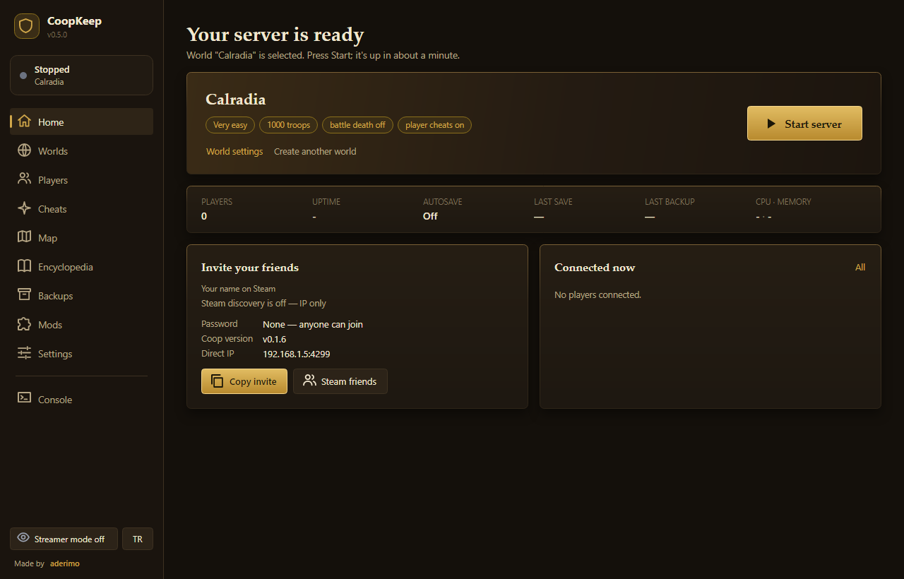
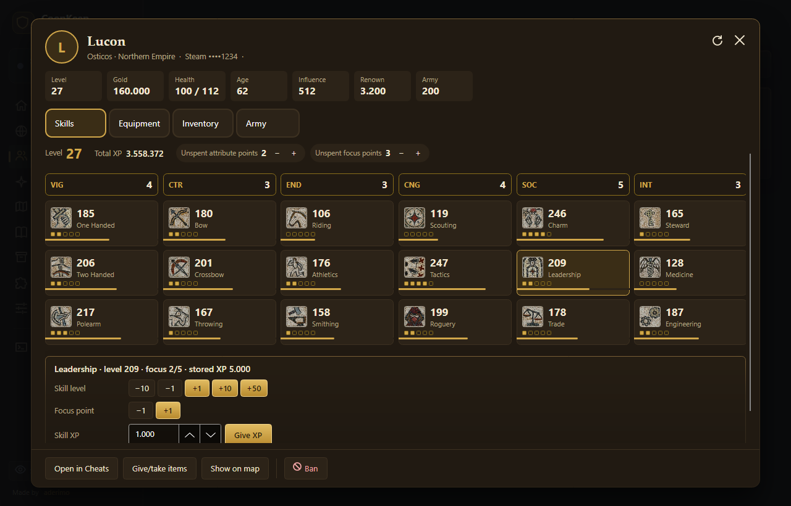
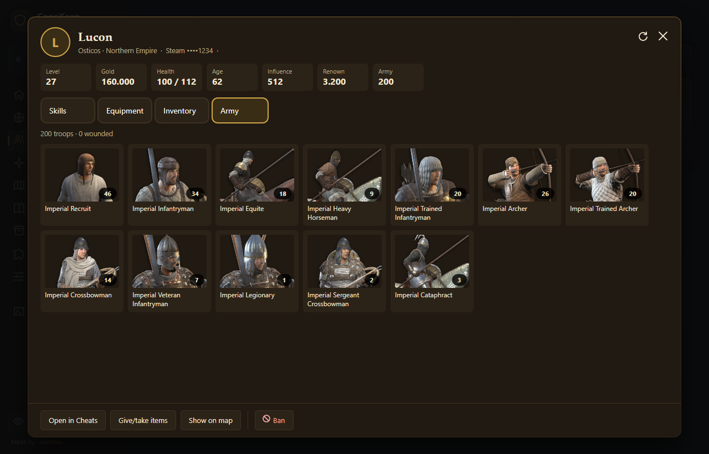
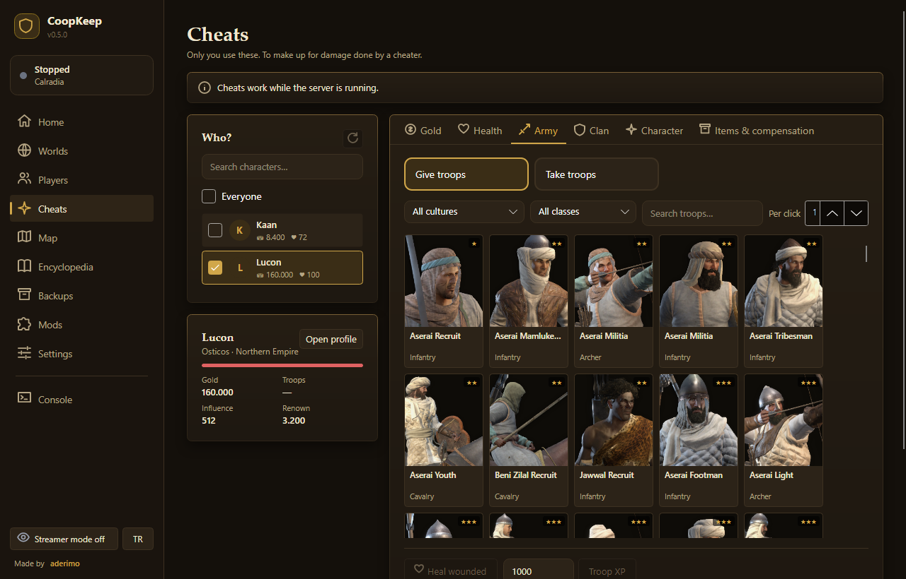
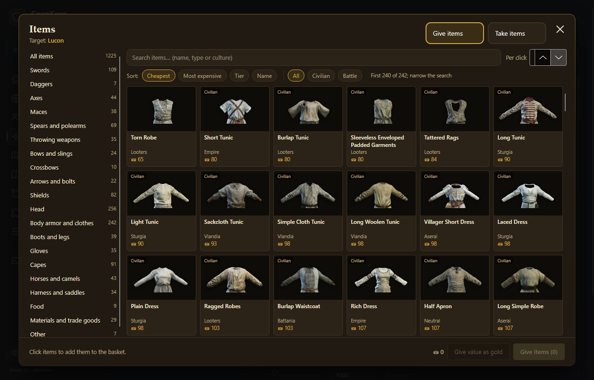
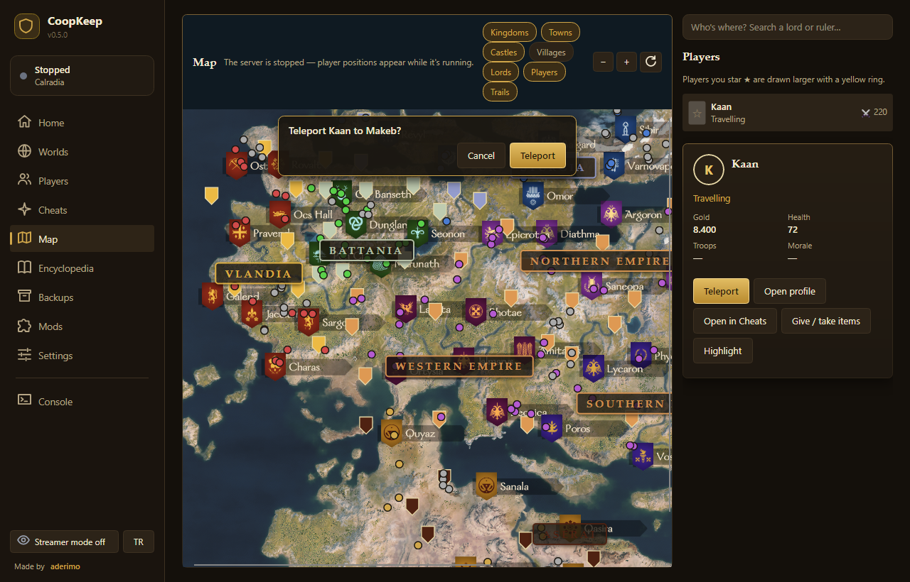
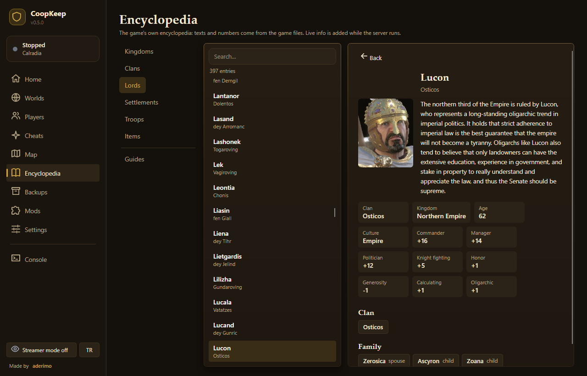
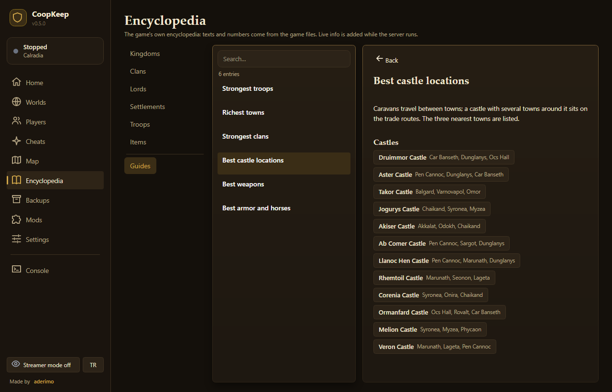
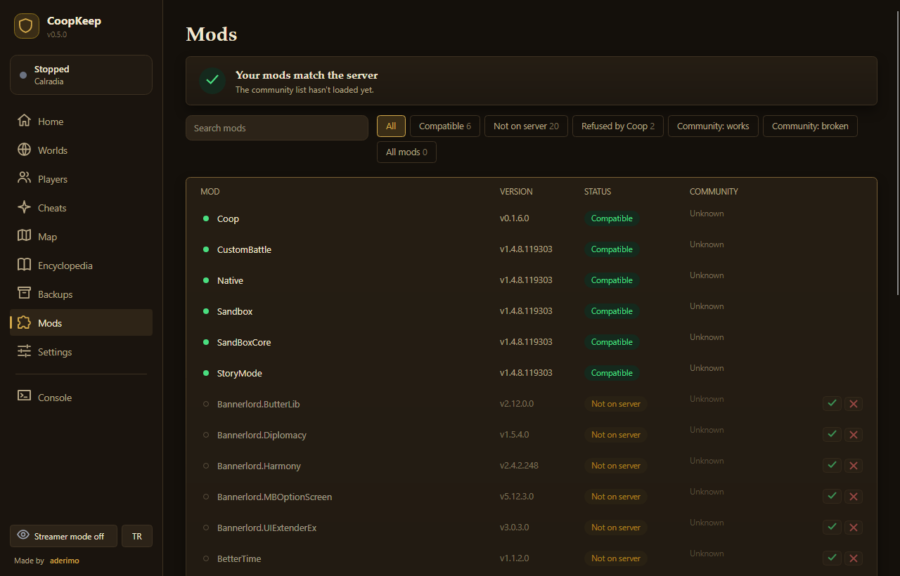

<div align="center">

# CoopKeep

**Bannerlord Coop server manager**

[](../../releases/latest)
[](LICENSE)
[](#install)

Host a Mount & Blade II: Bannerlord co-op campaign on your own PC — create the world,
start the server, manage players, fix what cheaters broke and watch the whole of
Calradia live. No command line, no editing config files, no creating a save in-game first.

**English** · [Türkçe](README.tr.md)

**[⬇ Download CoopKeep.exe](../../releases/latest)**



</div>

---

## Contents

[Why](#why) · [Install](#install) · [How to use](#how-to-use) · [Features](#features) ·
[Server plugin](#the-coopkeep-server-plugin) · [Troubleshooting](#troubleshooting) ·
[Known limitations](#known-limitations) · [Development](#development)

---

## Why

The Bannerlord Coop mod makes co-op campaigns work, but running one is all manual:
unblock DLLs, create a singleplayer save first, edit `server-config.json` in Notepad,
keep a console window open, copy files by hand when a save breaks — and when a player
cheats, there is nothing you can do about it.

CoopKeep takes all of that over in one window.

---

## Install

| | |
|---|---|
| Game | Mount & Blade II: Bannerlord **v1.4.8** (Steam) |
| Mod | [Bannerlord Coop](https://steamcommunity.com/sharedfiles/filedetails/?id=3770450698) — subscribe on the Steam Workshop |
| OS | Windows 10/11 |
| .NET | **Not required** — the exe is self-contained |

1. Install **Bannerlord** from Steam
2. Subscribe to **Bannerlord Coop** on the Steam Workshop
3. Download **`CoopKeep.exe`** from [Releases](../../releases/latest)
4. Double-click it. That's it.

> **No installer.** Keep the exe wherever you like; to uninstall, delete it.
> Nothing is copied into the game folder. The only exception is the optional
> [server plugin](#the-coopkeep-server-plugin), which is removed again when you turn it off.

**Your friends do not need CoopKeep.** They subscribe to the same mod and join from the game.

---

## How to use

### 1 · Create a world

The home page offers **Create a world**. The wizard works like starting a new campaign:
start fresh or continue a single-player campaign, pick a name, a difficulty
(Very easy / Easy / Realistic or every option by hand), the rules and the server
password. The world is created **instantly** — you never have to enter the game.


### 2 · Start

Press **Start server**. The first time, the Coop server's license agreement is shown.
The home page follows the boot (`Booting engine` → `Loading world` → **`Online`**), about a minute.

### 3 · Invite your friends

**Copy invite** puts everything they need in one message. They open the game →
**Coop** → **Steam Lobbies** and search for **your Steam name** — not the server name.
For a direct IP join, forward **UDP 4200** on your router.

---

## Features

### Worlds and server
- **New world wizard** with difficulty presets and every gameplay option of the Coop mod;
  each world keeps its own settings
- Import a single-player save; rename, duplicate, delete
- Start, stop safely, restart with a 60-second warning, **automatic restart on crash**
- **Automatic backup after every save**, transactional restore


### Players
- Live list, search, kick, broadcast
- **Steam bans** through the Coop server's own ban list — no restart needed
- **Player profile:** level, gold, health, age, influence, renown, the skills screen,
  battle and civilian equipment with real item images, inventory and army



<table><tr>
<td></td>
<td></td>
</tr></table>

### Cheats — repair what a cheater broke
Pick one player, several or everyone:
- Gold, health, clan influence and renown, age
- **Troops by type and count** with their real portraits; take troops away; heal the wounded
- **Items:** every item in the game, grouped and searchable, with the cheapest and most
  expensive town price
- **Skills screen like the game's:** click a skill for level, focus or XP, an attribute for points
- Recent actions can be undone; every action is verified and goes to an audit log


<table><tr>
<td></td>
<td></td>
</tr></table>

### Live map
- The real Calradia map with towns, castles, villages and kingdom names
- Players and **all lords** move live; click anything for an info card
- Capture alerts when a town or castle changes hands
- **Teleport from the map:** pick a player → Teleport → click or search a settlement
- **Viewer mode:** friends can watch your map from their own CoopKeep




### Encyclopedia
- Kingdoms, clans, lords, settlements, troops (upgrade trees) and items with the game's
  own encyclopedia texts
- **Guides** computed from the game's data: strongest troops per tier, richest towns,
  strongest clans, best castle locations, best weapons, armor and horses
- Live owner, prosperity and lord location while the server runs

<table><tr>
<td></td>
<td></td>
</tr></table>

### Mods
- Status of every module in your launcher (compatible / not on server / refused by Coop)
- **Set up for Coop:** turn off problem mods in one click, restore them later
- A list of all known mods with community results; click one for its description



### Other
- **Streamer mode** masks your IP, port and Steam name and blurs the console
- Bug report zip with logs and settings (password and Steam IDs masked)
- Update check, English and Turkish

---

## The CoopKeep server plugin

Items, skills, the player profile and the fast map need a small **CoopKeep server
plugin**, because the Coop mod has no commands for them.

- It is **off until you turn it on** (Settings, or the Items screen).
- When on, CoopKeep adds it as an extra sub-module to the Coop mod's own folder and keeps a
  backup of the original file. Coop's own assemblies are not changed.
- When you turn it off, it is removed again.
- Only the server console can use its commands; players cannot.

---

## Command line

```bash
coopkeep doctor          # locate the installation and check compatibility
coopkeep saves           # list servers with their players
coopkeep new Calradia    # create a new world (without entering the game)
coopkeep use Calradia    # switch the active server
coopkeep run             # start and drive the console
```

---

## Troubleshooting

| Problem | Cause and fix |
|---|---|
| **My friend can't find the server** | Are they searching for **your Steam name**? Not the server name. |
| **They can't connect** | Check the **Mods** page. Disable extra mods in the game launcher. |
| **Start does nothing** | A Coop server may already be running — CoopKeep warns about this. Close it from Task Manager. |
| **The password doesn't work** | Press **Start** after typing it; the server only reads settings at boot. |
| **The server closes right away (code 6)** | The Coop server's license agreement was not accepted. Start again from CoopKeep and accept it. |
| **Skills, items or the profile are empty** | Turn on the server plugin in Settings and restart the server. |
| **Importing a save is refused** | The save was made with mods the server can't load. Start a new sandbox without mods, save, and import that. |
| **Mod DLLs fail to load** | Windows may have blocked them. In the mod folder run:<br>`Get-ChildItem "<mod folder>" -Recurse \| Unblock-File` |

---

## Known limitations

These are limits of the mod itself, not gaps in CoopKeep:

- **No player cap.** Bannerlord Coop does not enforce a slot limit.
- **The game's own console cheats stay off** on the server. CoopKeep works through
  Coop's own commands and the optional server plugin.
- **Renown cannot be taken away**, and there is no god mode.
- **Skill XP follows the game's learning rate** — at high levels it barely moves the
  level, so the skills screen can also change the level directly.
- **No other mods on the server.** It loads the official modules and Coop only.
- Only **Steam** installations are detected; **one server at a time**.

Full history: [CHANGELOG.md](CHANGELOG.md)

---

## How it works

The dedicated server verifies four Coop assemblies with SHA-256 and refuses to boot if
they change, so CoopKeep never touches them. It works through:

| Channel | Used for |
|---|---|
| Process lifecycle | Start, stop, crash detection |
| stdin commands | `status` · `players` · `save` · `say` · `kick` · `stop`, an allow-list of Coop console commands, and the plugin's `coopkeep.*` commands |
| stdout `@DS@` events | Status phase, live player list |
| File system | `server-config.json`, `Game Saves\`, backups, Coop's `mod-config.json` and `steam-bans.json` |
| Game files (read only) | Settlements, clans, lords, troops, items and the game's own translations |

The configuration file is edited **preserving its comments, key order and unknown keys**.

---

## Development

```bash
dotnet test                                    # 309 tests
dotnet run --project src/CoopKeep.Cli -- doctor
powershell -File publish.ps1                   # produces the single-file exe
```

| Project | Responsibility |
|---|---|
| `src/CoopKeep.Core` | Process supervision, protocol, backups, game data, encyclopedia — **UI-independent** |
| `src/CoopKeep.App` | Avalonia UI (English/Turkish, dark theme) |
| `src/CoopKeep.Cli` | Command line tool |
| `src/CoopKeep.ServerTools` | The optional server plugin (built against the server's game DLLs) |
| `tests/CoopKeep.Core.Tests` | 309 tests |

The single source of the version number is `Directory.Build.props`.

Contributions welcome. Comments, commit messages and tests are written in Turkish;
English is fine for issues and pull requests.

---

## License

[MIT](LICENSE) — use, modify and redistribute freely.

CoopKeep is an **independent tool**. It is not affiliated with the Bannerlord Coop team or
TaleWorlds and contains none of their code. Game texts are read from your own installation;
images come from your installation or are downloaded from community wikis to your computer.

<div align="center">

Made by · **[aderimo](https://gitgit.me/aderimo)**

</div>
