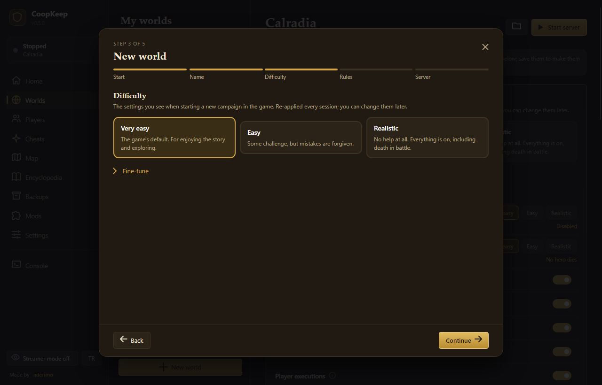
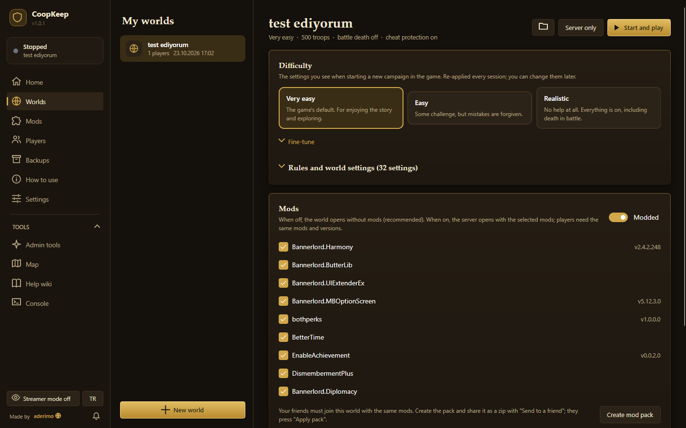
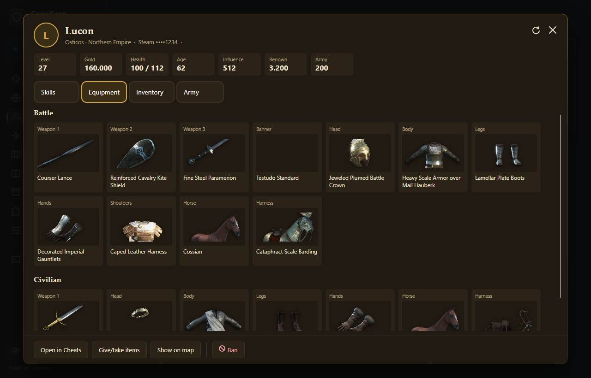
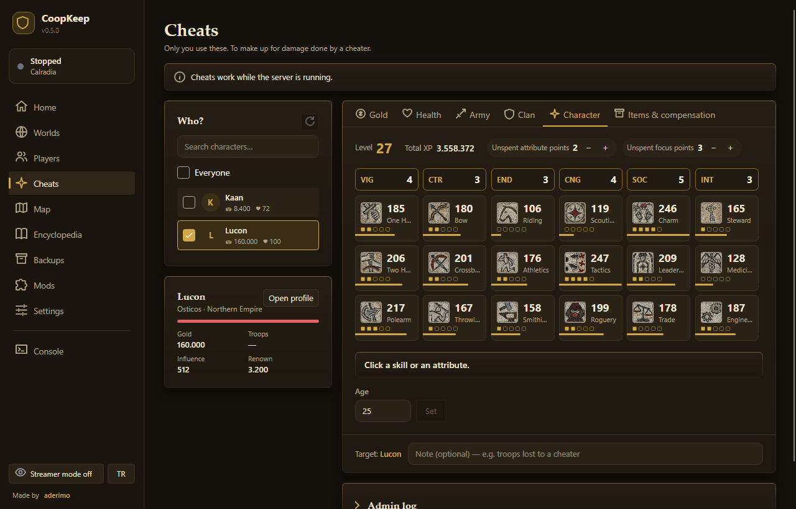
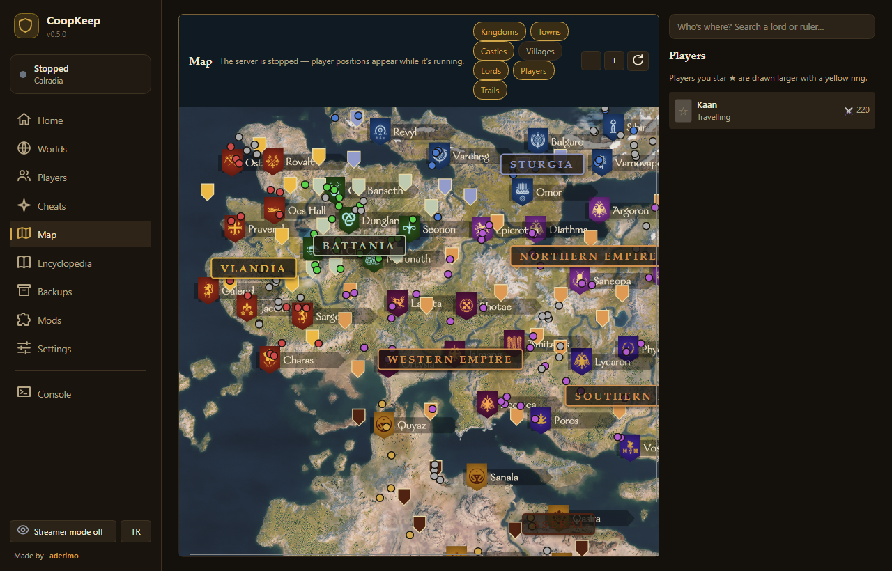

<div align="center">

# CoopKeep

**Bannerlord Coop server manager**

[](../../releases/latest)
[](LICENSE)
[](#install)

A launcher and server manager for the **Bannerlord Coop** mod. Host a Mount & Blade II:
Bannerlord co-op campaign on your own PC — create the world, start the server, play with
mods, manage players, fix what cheaters broke and watch the whole of Calradia live.
No command line, no editing config files, no creating a save in-game first.

**English** · [Türkçe](README.tr.md)

**[⬇ Download CoopKeep.exe](../../releases/latest)**


</div>

---

## Contents

[Why](#why) · [Install](#install) · [How to use](#how-to-use) · [Playing with mods](#playing-with-mods) ·
[Features](#features) · [Server plugin](#the-coopkeep-server-plugin) · [Troubleshooting](#troubleshooting) ·
[Known limitations](#known-limitations) · [Development](#development)

---

## Why

The Bannerlord Coop mod makes co-op campaigns work, but running one is all manual:
unblock DLLs, create a singleplayer save first, edit `server-config.json` in Notepad,
keep a console window open, copy files by hand when a save breaks — and when a player
cheats, there is nothing you can do about it.

CoopKeep takes all of that over in one window — and it knows the Coop mod's traps
(version and DLC mismatches, blocked DLLs, a missing save that silently becomes a new
world, Steam not running, exit codes nobody explains) and tells you what to do.

---

## Install

| | |
|---|---|
| Game | Mount & Blade II: Bannerlord **v1.4.8** (Steam or Epic) |
| Mod | [Bannerlord Coop](https://steamcommunity.com/sharedfiles/filedetails/?id=3770450698) — subscribe on the Steam Workshop |
| OS | Windows 10/11 |
| .NET | **Not required** — the exe is self-contained |

1. Install **Bannerlord** from Steam
2. Subscribe to **Bannerlord Coop** on the Steam Workshop
3. Download **`CoopKeep.exe`** from [Releases](../../releases/latest)
4. Double-click it. The **setup check** on the home page lists anything still missing
   (game version, Coop, its server package, DLCs, blocked files, firewall) with a button
   that fixes each one. The **How to use** page walks through every step.

> **No installer.** Keep the exe wherever you like; to uninstall, delete it.
> Nothing is copied into the game folder. The only exception is the optional
> [server plugin](#the-coopkeep-server-plugin), which is removed again when you turn it off.

**Your friends do not need CoopKeep.** They subscribe to the same mod and join from the game.

---

## How to use

### 1 · Create a world

The home page offers **Create a world**. The wizard works like starting a new campaign:
start fresh or continue a single-player campaign, pick a name, a difficulty
(Very easy / Easy / Realistic or every option by hand), the rules, mods (optional) and the
server password. The world is created **instantly** — you never have to enter the game.



### 2 · Start

Press **Start server**. The first time, the Coop server's license agreement is shown.
Before it starts, CoopKeep checks the usual traps and warns you (for example: the save is
missing, Steam is not running, a world mod is not installed). The server runs in the
background without a game window; the home page follows the boot (`Booting engine` →
`Loading world` → **`Online`**), about a minute.

To play on the same PC press **Play**: the game opens with Coop and the world's mods and
the server address is copied to your clipboard — paste it in the Coop menu.

### 3 · Invite your friends

**Copy invite** puts everything they need in one message. They open the game →
**Coop** → **Steam Lobbies** and search for **your Steam name** — not the server name.
For a direct IP join, forward **UDP 4200** on your router.

---

## Playing with mods

Coop compares the mods on the server and on every player **exactly, both ways** (same
mods, same versions; DLCs like War Sails off). Playing without mods is the smoothest; for
modded play CoopKeep does the bookkeeping:

1. In the wizard (or on **Worlds**) make the world **Modded** and tick its mods.
2. When you start, CoopKeep copies those mods into the Coop server's module folder (only
   the parts a server reads) and starts the server with them. Coop's own files are never
   touched; switching back to an unmodded world removes them again.
3. **Create mod pack** on the Worlds page and send it to your friends (**Mods → Packs →
   Send to a friend**). They press **Apply pack**: missing Workshop mods are subscribed,
   bundled ones installed, the launcher set to exactly the same list and order.
4. **Copy invite** lists the world's mods so nobody joins with the wrong set.

> Modded servers are **experimental**: whether a mod works in multiplayer depends on the
> mod. The Mods page marks mods the community reported as broken with Coop.

---

## Features

### Worlds and server
- **New world wizard** with difficulty presets and every gameplay option of the Coop mod;
  each world keeps its own settings
- Import a single-player save; rename, duplicate, delete
- Start, stop safely, restart with a 60-second warning, **automatic restart on crash**
- **Automatic backup after every save**, transactional restore



### Players
- Live list, search, kick, broadcast
- **Steam bans** through the Coop server's own ban list — no restart needed
- **Player profile:** level, gold, health, age, influence, renown, the skills screen,
  battle and civilian equipment with real item images, inventory and army


<table><tr>
<td></td>
<td></td>
</tr></table>

### Admin tools — repair what a cheater broke
Pick one player, several or everyone:
- Gold, health, clan influence and renown, age
- **Troops by type and count** with their real portraits; take troops away; heal the wounded
- **Items:** every item in the game, grouped and searchable, with the cheapest and most
  expensive town price
- **Skills screen like the game's:** click a skill for level, focus or XP, an attribute for points
- Recent actions can be undone; every action is verified and goes to an audit log



<table><tr>
<td></td>
<td></td>
</tr></table>

### Live map
- The real Calradia map with towns, castles, villages and kingdom names
- Players and **all lords** move live; click anything for an info card
- Capture alerts when a town or castle changes hands
- **Teleport from the map:** pick a player → Teleport → click or search a settlement
- **Viewer mode:** friends can watch your map from their own CoopKeep




### Encyclopedia
- Kingdoms, clans, lords, settlements, troops (upgrade trees) and items with the game's
  own encyclopedia texts
- **Guides** computed from the game's data: strongest troops per tier, richest towns,
  strongest clans, best castle locations, best weapons, armor and horses
- Live owner, prosperity and lord location while the server runs

<table><tr>
<td></td>
<td></td>
</tr></table>

### Mods
- **Mod manager:** enable/disable, reorder (dependency-aware), install from zip, remove
  (moved to a backup folder)
- **Find mods** on the Steam Workshop and Nexus Mods (your own API key; Premium downloads directly)
- **Mod packs:** create, send to a friend as a zip with instructions, import and apply
- Status of every module (compatible / not on server / refused by Coop) and
  **Set up for Coop** to turn off problem modules in one click
- Community results for known mods; click one for its description


### Setup check and guide
- The home page checks the game version, Coop and its server package, DLCs, files
  Windows blocked, and the firewall — each with a one-click fix
- Before starting: a missing save (Coop would silently start a new world), missing world
  mods, Steam not running, broken Coop environment variables, OneDrive
- When the server stops, the exit code is explained with what to do next (2: restore a
  backup, 4: refresh Coop on the Workshop, 6: license agreement)
- **How to use** page with every step and the most common problems

### Other
- **Streamer mode** masks your IP, port and Steam name and blurs the console
- Bug report zip with logs and settings (password and Steam IDs masked)
- Update check, English and Turkish

---

## The CoopKeep server plugin

Items, skills, the player profile and the fast map need a small **CoopKeep server
plugin**, because the Coop mod has no commands for them.

- It is **off until you turn it on** (Settings, or the Items screen).
- When on, CoopKeep adds it as an extra sub-module to the Coop mod's own folder and keeps a
  backup of the original file. Coop's own assemblies are not changed.
- When you turn it off, it is removed again.
- Only the server console can use its commands; players cannot.

---

## Command line

```bash
coopkeep doctor          # locate the installation and check compatibility
coopkeep saves           # list servers with their players
coopkeep new Calradia    # create a new world (without entering the game)
coopkeep use Calradia    # switch the active server
coopkeep run             # start and drive the console
```

---

## Troubleshooting

| Problem | Cause and fix |
|---|---|
| **My friend can't find the server** | Are they searching for **your Steam name**? Not the server name. |
| **They can't connect** | Check the **Mods** page. Disable extra mods in the game launcher. |
| **Start does nothing** | A Coop server may already be running — CoopKeep warns about this. Close it from Task Manager. |
| **The password doesn't work** | Press **Start** after typing it; the server only reads settings at boot. |
| **The server closes right away (code 6)** | The Coop server's license agreement was not accepted. Start again from CoopKeep and accept it. |
| **Skills, items or the profile are empty** | Turn on the server plugin in Settings and restart the server. |
| **Importing a save is refused** | The save was made with mods the server can't load. Start a new sandbox without mods, save, and import that. |
| **Mod DLLs fail to load** | Windows blocked them. The setup check on Home finds them; press **Unblock**. |
| **The server closes right away (code 4)** | Coop was updated or its files changed. Unsubscribe from Coop on the Workshop and subscribe again. If the server plugin is on, turn it off and retry. |
| **The server closes right away (code 2)** | The save could not be loaded (damaged, or made with other mods). Restore the last good save from **Backups**. |
| **A brand-new world opened** | The configured save was missing — Coop then starts a new world. CoopKeep now warns before starting; restore from **Backups**. |
| **Stuck on "Loading host save"** | Leave and reconnect; if it persists, restart the server. |
| **Big battles are very slow** | Battles over ~200 troops are heavy for Coop; lower the battle size in the world settings. |
| **A mod is on the PC but the game/launcher doesn't show it** | It was downloaded by **another Steam account** on this PC. The game only sees Workshop mods the current account is subscribed to. CoopKeep shows a "Subscribe on Steam" button on those mods. |
| **Modded server says a needed mod is missing** | Check the mod's row on the Mods page: install it, or subscribe if it says "not subscribed". The list refreshes when you come back to CoopKeep. |
| **Windows says "Windows protected your PC"** | The exe is unsigned, so this shows on first launch. Click **More info → Run anyway**. |

---

## Known limitations

These are limits of the mod itself, not gaps in CoopKeep:

- **No player cap.** Bannerlord Coop does not enforce a slot limit.
- **The game's own console cheats stay off** on the server. CoopKeep works through
  Coop's own commands and the optional server plugin.
- **Renown cannot be taken away**, and there is no god mode.
- **Skill XP follows the game's learning rate** — at high levels it barely moves the
  level, so the skills screen can also change the level directly.
- **Mods on the server are experimental**; everyone needs the same mods and versions.
- **About 8 players** is the supported maximum for stability.
- **Steam and Epic** installs are detected. On Epic, install Coop by hand; friends on Epic get Workshop mods through a mod pack zip. **One server at a time**.

Full history: [CHANGELOG.md](CHANGELOG.md)

---

## How it works

The dedicated server verifies four Coop assemblies with SHA-256 and refuses to boot if
they change, so CoopKeep never touches them. It works through:

| Channel | Used for |
|---|---|
| Process lifecycle | Start, stop, crash detection |
| stdin commands | `status` · `players` · `save` · `say` · `kick` · `stop`, an allow-list of Coop console commands, and the plugin's `coopkeep.*` commands |
| stdout `@DS@` events | Status phase, live player list |
| File system | `server-config.json`, `Game Saves\`, backups, Coop's `mod-config.json` and `steam-bans.json` |
| Game files (read only) | Settlements, clans, lords, troops, items and the game's own translations |

The configuration file is edited **preserving its comments, key order and unknown keys**.

---

## Development

```bash
dotnet test                                    # 376 tests
dotnet run --project src/CoopKeep.Cli -- doctor
powershell -File publish.ps1                   # produces the single-file exe
```

| Project | Responsibility |
|---|---|
| `src/CoopKeep.Core` | Process supervision, protocol, backups, game data, encyclopedia — **UI-independent** |
| `src/CoopKeep.App` | Avalonia UI (English/Turkish, dark theme) |
| `src/CoopKeep.Cli` | Command line tool |
| `src/CoopKeep.ServerTools` | The optional server plugin (built against the server's game DLLs) |
| `tests/CoopKeep.Core.Tests` | 376 tests |

The single source of the version number is `Directory.Build.props`.

Contributions welcome. Comments, commit messages and tests are written in Turkish;
English is fine for issues and pull requests.

---

## License

[MIT](LICENSE) — use, modify and redistribute freely.

CoopKeep is an **independent tool**. It is not affiliated with the Bannerlord Coop team or
TaleWorlds and contains none of their code. Game texts are read from your own installation;
images come from your installation or are downloaded from community wikis to your computer.

<div align="center">

Made by · **[aderimo](https://gitgit.me/aderimo)**

</div>
