<div align="center">

# CoopKeep

**Bannerlord Coop sunucu yöneticisi**

[](../../releases/latest)
[](LICENSE)
[](#kurulum)

**Bannerlord Coop** modu için başlatıcı ve sunucu yöneticisi. Mount & Blade II: Bannerlord
co-op kampanyasını kendi bilgisayarında barındır: dünyayı kur, sunucuyu başlat, modlu oyna,
oyuncuları yönet, hilecilerin bozduğunu düzelt ve bütün Calradia'yı canlı izle. Komut satırı
yok, elle dosya düzenleme yok, oyuna girip save yaratma yok.

[English](README.md) · **Türkçe**

**[⬇ CoopKeep.exe'yi indir](../../releases/latest)**

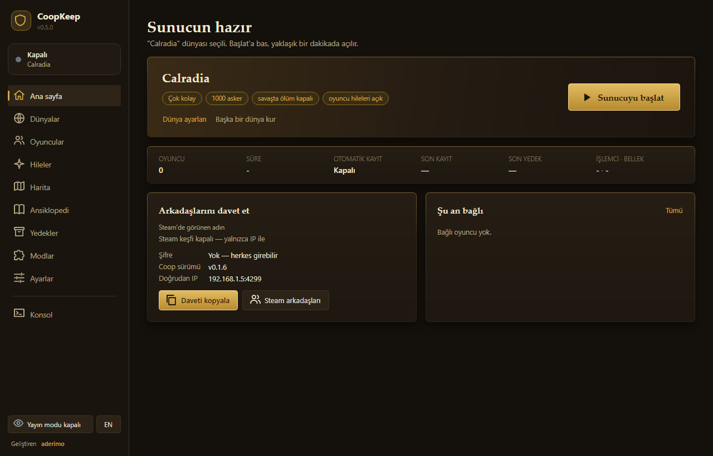

</div>

---

## İçindekiler

[Neden](#neden) · [Kurulum](#kurulum) · [Nasıl kullanılır](#nasıl-kullanılır) ·
[Modlu oynamak](#modlu-oynamak) · [Neler yapabilir](#neler-yapabilir) · [Sunucu eklentisi](#coopkeep-sunucu-eklentisi) ·
[Sorun giderme](#sorun-giderme) · [Bilinen sınırlar](#bilinen-sınırlar) · [Geliştirme](#geliştirme)

---

## Neden

Bannerlord Coop modu co-op kampanyayı çalışır hâle getiriyor, ama işletme tarafı tamamen
elle: DLL'lerin engelini kaldırmak, önce oyunda tek oyunculu bir save yaratmak,
`server-config.json`'ı Notepad'le düzenlemek, konsol penceresini açık tutmak, save
bozulursa dosyaları elle kopyalamak. Bir oyuncu hile yaparsa da elinden bir şey gelmiyor.

CoopKeep bunların hepsini tek pencerede üstlenir. Coop modunun tuzaklarını da bilir: sürüm
ve DLC uyuşmazlığı, engellenmiş DLL'ler, yokken sessizce yeni dünyaya dönüşen kayıt, kapalı
Steam, kimsenin açıklamadığı çıkış kodları. Ne yapman gerektiğini söyler.

---

## Kurulum

| | |
|---|---|
| Oyun | Mount & Blade II: Bannerlord **v1.4.8** (Steam ya da Epic) |
| Mod | [Bannerlord Coop](https://steamcommunity.com/sharedfiles/filedetails/?id=3770450698) — Steam Atölyesi'nden abone ol |
| İşletim sistemi | Windows 10/11 |
| .NET | **Gerekmez**; exe her şeyi içinde taşır |

1. **Bannerlord**'u Steam'den kur
2. Steam Atölyesi'nde **Bannerlord Coop**'a abone ol
3. [Releases](../../releases/latest) sayfasından **`CoopKeep.exe`** indir
4. Çift tıkla. Ana sayfadaki **kurulum denetimi** eksikleri listeler (oyun sürümü, Coop,
   sunucu paketi, DLC'ler, engellenmiş dosyalar, güvenlik duvarı) ve her birinin yanında
   düzelten bir düğme vardır. **Nasıl kullanılır** sayfası her adımı anlatır.

> **Kurulum gerektirmez.** Exe istediğin klasörde durabilir; kaldırmak için silmen yeterli.
> Oyun klasörüne hiçbir şey kopyalanmaz. Tek istisna isteğe bağlı
> [sunucu eklentisi](#coopkeep-sunucu-eklentisi); kapatınca geri kaldırılır.

**Arkadaşlarının CoopKeep'e ihtiyacı yok.** Aynı moda abone olup oyundan katılırlar.

---

## Nasıl kullanılır

### 1 · Dünyanı kur

Ana sayfada **Dünya oluştur** düğmesi çıkar. Sihirbaz oyunda yeni kampanya açmak gibidir:

1. Sıfırdan başla ya da tek oyunculu bir kampanyadan devam et.
2. Bir ad ver.
3. Zorluğu seç: Çok kolay, Kolay, Gerçekçi ya da her ayarı tek tek.
4. Kuralları, modları (isteğe bağlı) ve sunucu şifresini belirle.

Dünya **anında** kurulur; oyuna girmen hiç gerekmez.

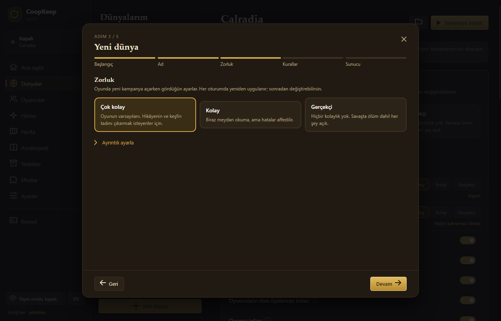

### 2 · Başlat

**Sunucuyu başlat**'a bas. İlk seferde Coop sunucusunun lisans sözleşmesi gösterilir.
Açılmadan önce CoopKeep bilinen tuzakları denetler ve uyarır (örneğin kayıt yok, Steam kapalı,
dünyanın bir modu kurulu değil). Sunucu oyun penceresi açmadan arka planda çalışır; ana sayfa
açılışı adım adım gösterir (`Motor açılıyor` → `Dünya yükleniyor` → **`Yayında`**). Yaklaşık
bir dakika sürer.

Aynı bilgisayarda oynamak için **Oyuna gir**'e bas: oyun Coop ve dünyanın modlarıyla açılır,
sunucunun adresi panoya kopyalanır; Coop menüsüne yapıştırman yeter.

### 3 · Arkadaşlarını çağır

**Daveti kopyala** gereken her şeyi tek mesajda verir. Arkadaşların oyunda **Coop** →
**Steam Lobbies**'e girip sunucu adını değil, **senin Steam adını** aratır. Doğrudan IP ile
bağlanmak için modemde **UDP 4200** portunu yönlendir.

---

## Modlu oynamak

Coop, sunucudaki ve her oyuncudaki modları **iki yönde birebir** karşılaştırır: aynı modlar,
aynı sürümler; War Sails gibi DLC'ler kapalı. Modsuz oynamak en sorunsuzudur. Modlu oyunda
hesabı CoopKeep tutar:

1. Sihirbazda (ya da **Dünyalar**'da) dünyayı **Modlu** yap ve modlarını işaretle.
2. Başlatınca CoopKeep bu modları Coop sunucusunun modül klasörüne kopyalar (yalnızca
   sunucunun okuduğu kısımları) ve sunucuyu onlarla açar. Coop'un kendi dosyalarına dokunulmaz;
   modsuz bir dünyaya dönünce modlar yeniden kaldırılır.
3. Dünyalar sayfasında **Mod paketini oluştur**, arkadaşlarına gönder (**Modlar → Paketler →
   Arkadaşa gönder**). Onlar **Paketi uygula** der: eksik Atölye modlarına abone olunur,
   paketle gelenler kurulur, başlatıcı birebir aynı liste ve sırayla ayarlanır.
4. **Daveti kopyala** dünyanın modlarını da yazar; kimse yanlış modlarla gelmez.

> Modlu sunucu **deneyseldir**: bir modun çok oyunculuda çalışıp çalışmaması moda bağlıdır.
> Modlar sayfası, topluluğun Coop ile çalışmadığını bildirdiği modları işaretler.

---

## Neler yapabilir

### Dünyalar ve sunucu
- Zorluk hazır ayarları ve Coop modunun bütün oyun seçenekleriyle **yeni dünya
  sihirbazı**. Her dünyanın kendi ayarları vardır.
- Tek oyunculu save içe aktarma; yeniden adlandırma, kopyalama, silme.
- Başlatma, güvenli durdurma, 60 saniye uyarılı yeniden başlatma.
- **Çökünce otomatik yeniden başlatma.**
- **Her kayıttan sonra otomatik yedek** ve güvenli geri yükleme.

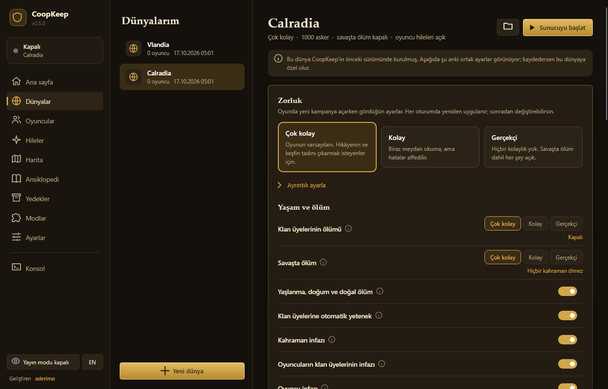

### Oyuncular
- Canlı liste, arama, atma, duyuru
- Coop sunucusunun kendi ban listesiyle **Steam banı**; yeniden başlatmak gerekmez
- **Oyuncu profili:** seviye, altın, can, yaş, nüfuz, ün, beceri ekranı, savaş ve şehir
  kuşanımı (gerçek eşya görselleriyle), envanter ve ordu

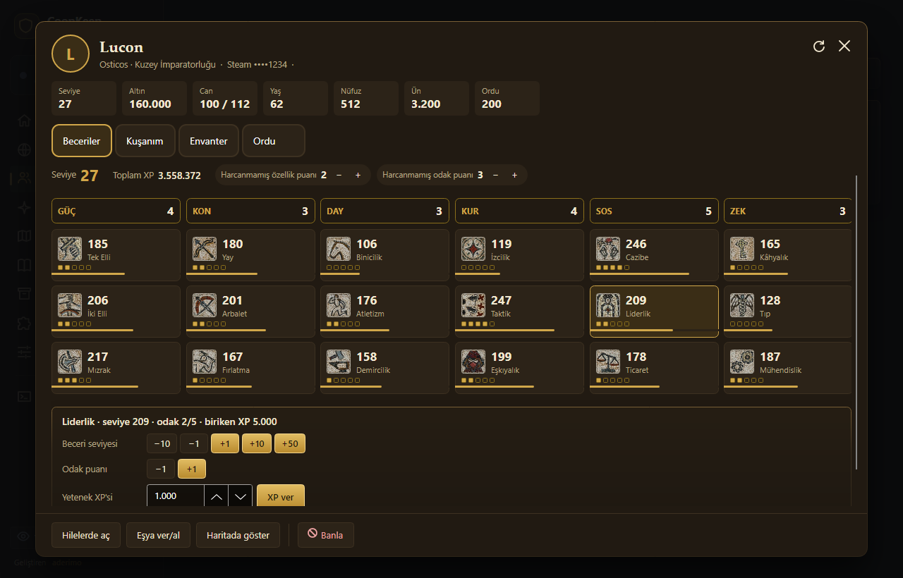

<table><tr>
<td>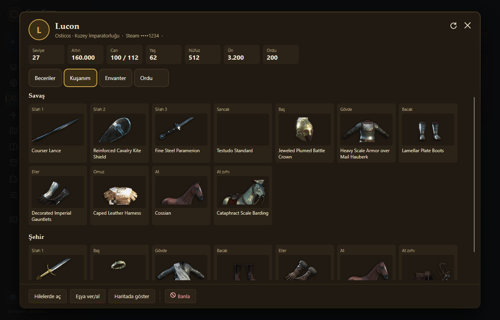</td>
<td>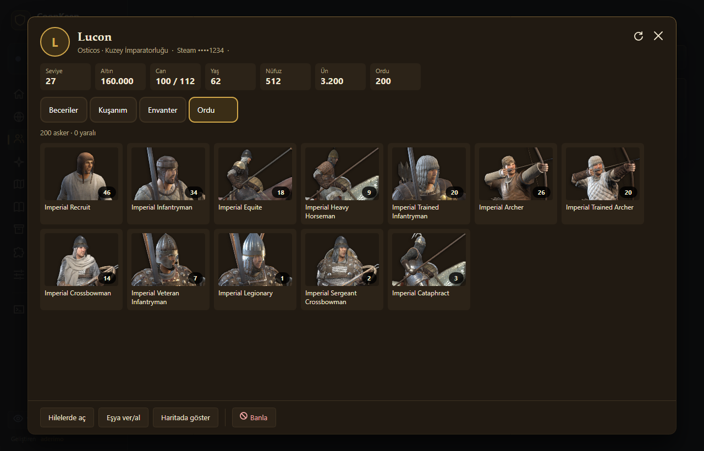</td>
</tr></table>

### Yönetici araçları: hilecinin bozduğunu düzelt
Bir oyuncuyu, birkaçını ya da herkesi seç:
- Altın, can, klan nüfuzu ve ünü, yaş
- Gerçek portreleriyle **tür ve sayı seçerek asker** ver; asker al; yaralıları iyileştir
- **Eşyalar:** oyundaki bütün eşyalar, gruplu ve aranabilir; en ucuz ve en pahalı kasaba fiyatıyla
- **Oyundaki gibi beceri ekranı:** beceriye tıklayınca seviye, odak ya da XP; özelliğe
  tıklayınca puan
- Son işlemler geri alınabilir; her işlem doğrulanır ve denetim kaydına yazılır

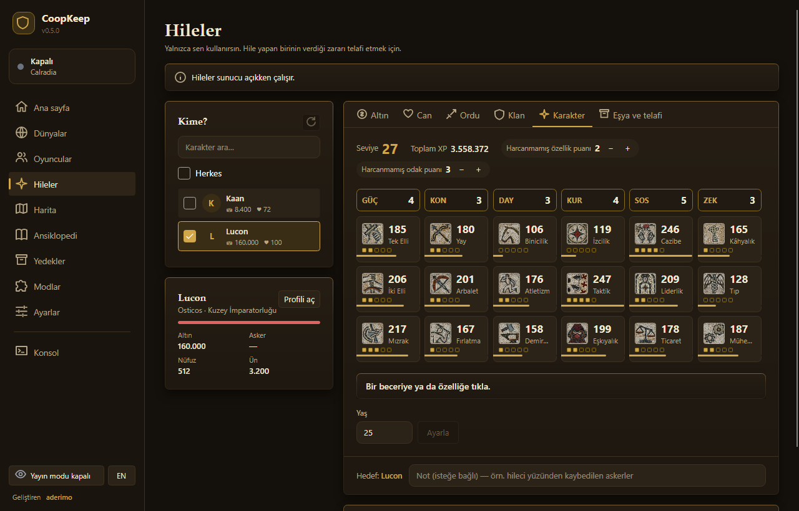

<table><tr>
<td>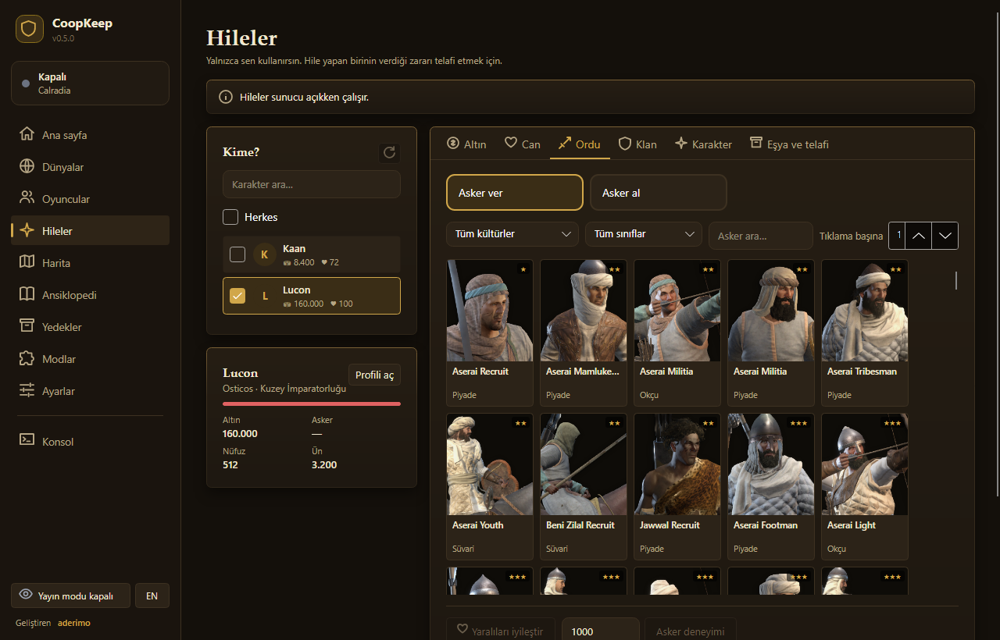</td>
<td>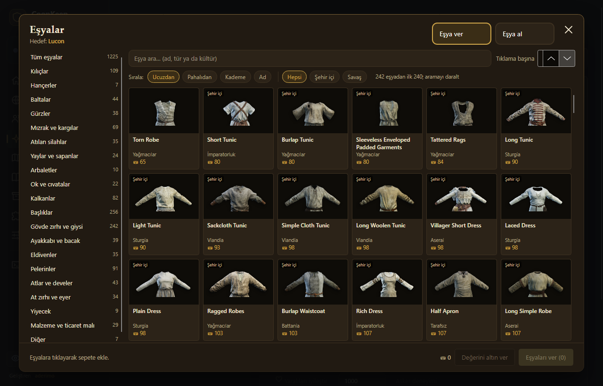</td>
</tr></table>

### Canlı harita
- Kasabalar, kaleler, köyler ve krallık adlarıyla gerçek Calradia haritası
- Oyuncular ve **bütün lordlar** canlı hareket eder; her şeye tıklayınca bilgi kartı açılır
- Kasaba ya da kale el değiştirince uyarı
- **Haritadan ışınlama:** oyuncuyu seç → Işınla → bir yerleşime tıkla ya da ara
- **İzleyici modu:** arkadaşların haritanı kendi CoopKeep'lerinden izleyebilir

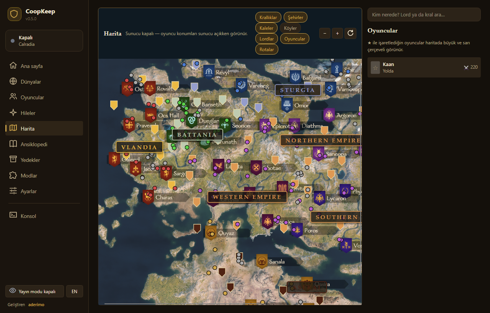
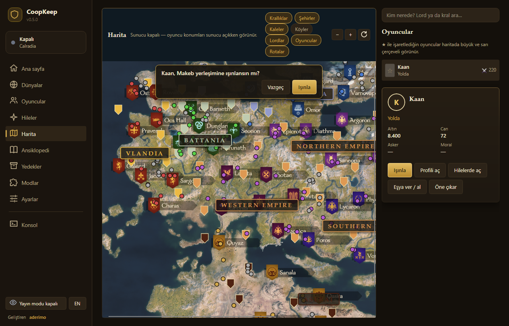

### Ansiklopedi
- Krallıklar, klanlar, lordlar, yerleşimler, askerler (terfi ağaçlarıyla) ve eşyalar
- Metinler oyunun kendi ansiklopedisinden, oyunun kendi Türkçe çevirisiyle gelir
- Oyun verilerinden hesaplanan **rehberler:** her kademede en güçlü askerler, en zengin
  kasabalar, en güçlü klanlar, en iyi kale konumları, en iyi silah, zırh ve atlar
- Sunucu açıkken canlı bilgiler: güncel sahip, refah, lordun yeri

<table><tr>
<td>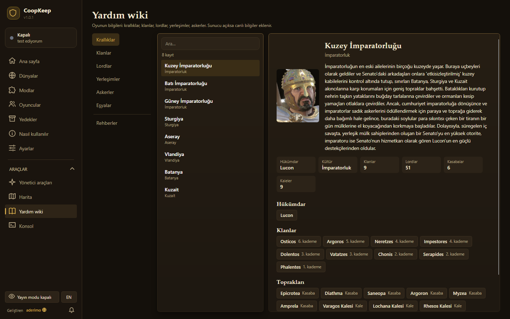</td>
<td>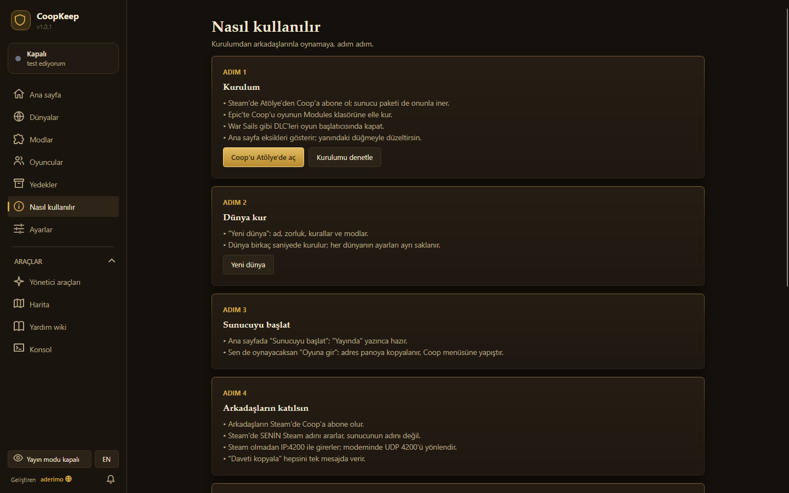</td>
</tr></table>

### Modlar
- **Mod yöneticisi:** aç/kapat, sırala (bağımlılıklara göre), zip'ten kur, kaldır (yedek
  klasörüne taşınır)
- Steam Atölyesi ve Nexus Mods'ta **mod bul** (kendi API anahtarınla; Premium'da doğrudan iner)
- **Mod paketleri:** oluştur, arkadaşa yönergeli zip olarak gönder, içe aktar ve uygula
- Her modülün durumu (uyumlu / sunucuda yok / Coop reddediyor) ve sorunlu modülleri tek
  tıkla kapatan **Coop için düzenle**
- Bilinen modlar için topluluk sonuçları; moda tıklayınca açıklaması açılır

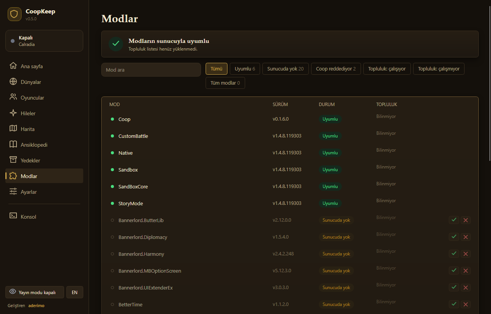

### Kurulum denetimi ve rehber
- Ana sayfa oyun sürümünü, Coop'u ve sunucu paketini, DLC'leri, Windows'un engellediği
  dosyaları ve güvenlik duvarını denetler; her birinde tek tıkla düzeltme
- Başlatmadan önce: kayıt yok (Coop sessizce yeni dünya açardı), dünyanın modları eksik,
  Steam kapalı, bozuk Coop ortam değişkenleri, OneDrive
- Sunucu kapanınca çıkış kodu ne yapılacağıyla birlikte açıklanır (2: yedekten dön, 4:
  Coop'u Atölye'de tazele, 6: lisans sözleşmesi)
- Her adımı ve en sık sorunları anlatan **Nasıl kullanılır** sayfası

### Diğer
- **Yayın modu:** IP'ni, portunu ve Steam adını gizler, konsolu bulanıklaştırır
- Günlükler ve ayarlarla hata raporu zip'i (şifre ve Steam kimlikleri gizlenir)
- Güncelleme kontrolü, Türkçe ve İngilizce

---

## CoopKeep sunucu eklentisi

Eşyalar, beceriler, oyuncu profili ve hızlı harita küçük bir **CoopKeep sunucu
eklentisi** gerektirir, çünkü Coop modunda bunlar için komut yok.

- **Sen açmadıkça kapalıdır** (Ayarlar ya da Eşyalar ekranı).
- Açınca CoopKeep onu Coop modunun kendi klasörüne ek bir alt modül olarak ekler ve asıl
  dosyanın yedeğini alır. Coop'un kendi dosyaları değişmez.
- Kapatınca geri kaldırılır.
- Komutlarını yalnızca sunucu konsolu kullanabilir; oyuncular kullanamaz.

---

## Komut satırı

```bash
coopkeep doctor          # kurulumu bul, uyumluluğu kontrol et
coopkeep saves           # sunucuları oyuncularıyla listele
coopkeep new Calradia    # yeni dünya kur (oyuna girmeden)
coopkeep use Calradia    # aktif sunucuyu değiştir
coopkeep run             # başlat ve konsolu kullan
```

---

## Sorun giderme

| Sorun | Sebep ve çözüm |
|---|---|
| **Arkadaşım sunucuyu bulamıyor** | **Senin Steam adını** mı arıyor? Sunucu adını değil. |
| **Bağlanamıyorlar** | **Modlar** sayfasına bak. Oyun başlatıcısında fazla modları kapatsınlar. |
| **Başlat bir şey yapmıyor** | Zaten çalışan bir Coop sunucusu olabilir; CoopKeep bunu uyarır. Görev Yöneticisi'nden kapat. |
| **Şifre çalışmıyor** | Yazdıktan sonra **Başlat**'a bas; sunucu ayarları yalnızca açılışta okur. |
| **Sunucu hemen kapanıyor (kod 6)** | Coop sunucusunun lisans sözleşmesi kabul edilmemiş. CoopKeep'ten yeniden başlatıp kabul et. |
| **Beceriler, eşyalar ya da profil boş** | Ayarlar'dan sunucu eklentisini aç ve sunucuyu yeniden başlat. |
| **Save içe aktarma reddediliyor** | Save, sunucunun yükleyemediği modlarla yapılmış. Oyunda modsuz yeni sandbox açıp kaydet ve onu içe aktar. |
| **Mod DLL'leri yüklenmiyor** | Windows engellemiş. Ana sayfadaki kurulum denetimi bulur; **Engeli kaldır**'a bas. |
| **Sunucu hemen kapanıyor (kod 4)** | Coop güncellenmiş ya da dosyaları değişmiş. Atölye'de Coop'tan abonelikten çık, yeniden abone ol. Sunucu eklentisi açıksa kapatıp yeniden dene. |
| **Sunucu hemen kapanıyor (kod 2)** | Kayıt yüklenemedi (bozuk ya da başka modlarla yapılmış). **Yedekler**'den son sağlam kaydı geri yükle. |
| **Bomboş yeni bir dünya açıldı** | Ayarlı kayıt bulunamamış; Coop o zaman yeni dünya başlatır. CoopKeep artık başlatmadan önce uyarır; **Yedekler**'den geri yükle. |
| **"Host kaydı yükleniyor"da takılıyor** | Çıkıp yeniden bağlan; sürerse sunucuyu yeniden başlat. |
| **Büyük savaşlar çok yavaş** | ~200 askerden büyük savaşlar Coop için ağır; dünya ayarlarında savaş boyutunu düşür. |
| **Mod bilgisayarda var ama oyun/başlatıcı görmüyor** | Mod, aynı bilgisayardaki **başka bir Steam hesabıyla** inmiş. Oyun yalnızca açık hesabın abone olduğu Atölye modlarını görür. CoopKeep bu modların yanına "Steam'de abone ol" düğmesi koyar. |
| **Modlu sunucuda "gereken mod yok" diyor** | Modlar sayfasında modun satırına bak: kurulu değilse kur, "abone değil" diyorsa abone ol. CoopKeep'e dönünce liste kendiliğinden yenilenir. |
| **Windows "bilgisayarınız korundu" diyor** | Exe imzasız olduğu için ilk açılışta çıkar. **Ek bilgi → Yine de çalıştır**. |

---

## Bilinen sınırlar

Bunlar CoopKeep'in eksiği değil, modun kendi sınırları:

- **Oyuncu sınırı yok.** Bannerlord Coop slot sınırı uygulamıyor.
- **Oyunun kendi konsol hileleri sunucuda kapalı.** CoopKeep, Coop'un kendi komutları ve
  isteğe bağlı sunucu eklentisiyle çalışır.
- **Ün azaltılamıyor**, tanrı modu yok.
- **Yetenek XP'si oyunun öğrenme hızıyla işler.** Yüksek seviyede seviyeyi pek
  değiştirmez; bu yüzden beceri ekranı seviyeyi doğrudan da değiştirebilir.
- **Sunucuda mod deneyseldir**; herkeste aynı modlar ve sürümler olmalı.
- Kararlılık için **en fazla 8 oyuncu** önerilir.
- **Steam ve Epic** kurulumları bulunur. Epic'te Coop elle kurulur; Epic'teki arkadaşlar Atölye modlarını mod paketi zip'iyle alır. **Aynı anda tek sunucu**.

Tüm geçmiş: [CHANGELOG.md](CHANGELOG.md)

---

## Nasıl çalışır

Dedicated server, Coop'un dört dosyasını SHA-256 ile doğrular ve değişmişlerse açılmayı
reddeder. Bu yüzden CoopKeep onlara hiç dokunmaz. Şu kanallarla çalışır:

| Kanal | Ne için |
|---|---|
| Süreç yaşam döngüsü | Başlatma, durdurma, çökme tespiti |
| stdin komutları | `status` · `players` · `save` · `say` · `kick` · `stop`, izin listesindeki Coop konsol komutları ve eklentinin `coopkeep.*` komutları |
| stdout `@DS@` olayları | Durum aşaması, canlı oyuncu listesi |
| Dosya sistemi | `server-config.json`, `Game Saves\`, yedekler, Coop'un `mod-config.json` ve `steam-bans.json` dosyaları |
| Oyun dosyaları (salt okunur) | Yerleşimler, klanlar, lordlar, askerler, eşyalar ve oyunun kendi çevirileri |

Yapılandırma dosyası **yorumları, anahtar sırası ve tanınmayan anahtarlar korunarak** düzenlenir.

---

## Geliştirme

```bash
dotnet test                                    # 376 test
dotnet run --project src/CoopKeep.Cli -- doctor
powershell -File publish.ps1                   # tek dosyalık exe üretir
```

| Proje | Görevi |
|---|---|
| `src/CoopKeep.Core` | Süreç yönetimi, protokol, yedekler, oyun verileri, ansiklopedi (**arayüzden bağımsız**) |
| `src/CoopKeep.App` | Avalonia arayüzü (Türkçe/İngilizce, koyu tema) |
| `src/CoopKeep.Cli` | Komut satırı aracı |
| `src/CoopKeep.ServerTools` | İsteğe bağlı sunucu eklentisi (sunucunun oyun DLL'leriyle derlenir) |
| `tests/CoopKeep.Core.Tests` | 376 test |

Sürüm numarasının tek kaynağı `Directory.Build.props` dosyasıdır.

Katkılara açığız. Yorumlar, commit mesajları ve testler Türkçe yazılır; issue ve pull
request için İngilizce de olur.

---

## Lisans

[MIT](LICENSE): dilediğin gibi kullan, değiştir, dağıt.

CoopKeep **bağımsız bir araçtır**. Bannerlord Coop ekibi ya da TaleWorlds ile bağı yoktur
ve onların kodunu içermez. Oyun metinleri kendi kurulumundan okunur. Görseller ya kendi
kurulumundan gelir ya da topluluk wiki'lerinden bilgisayarına indirilir.

<div align="center">

Geliştiren · **[aderimo](https://gitgit.me/aderimo)**

</div>
